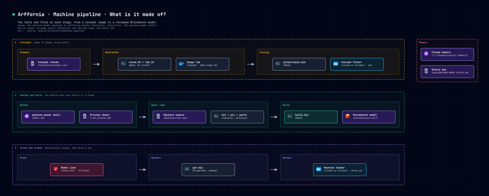
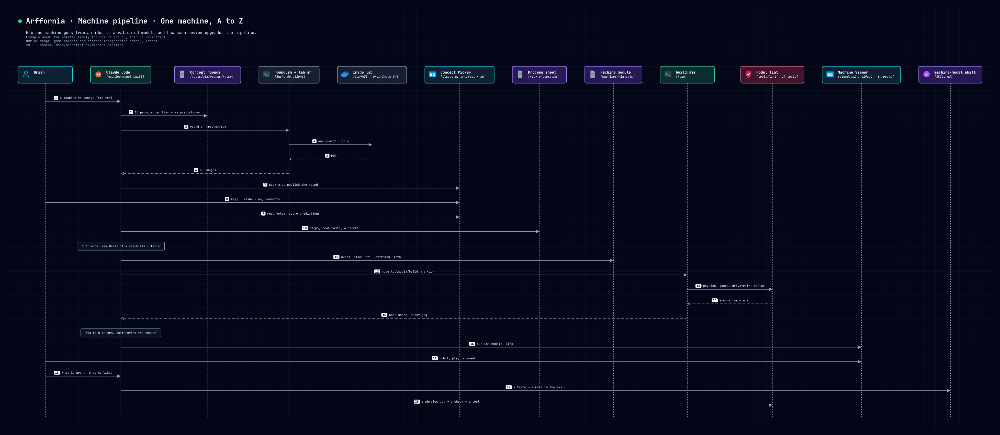
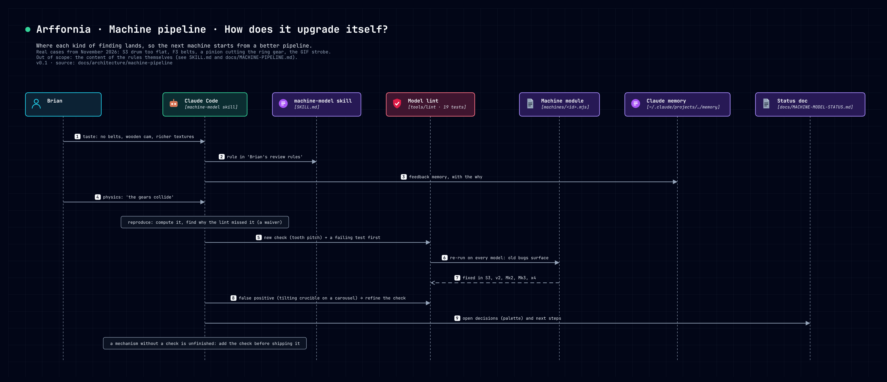

# Machine pipeline, A to Z

How an Arffornia machine goes from an idea to a validated, animated Blockbench model, who does what,
how every step is checked, and how the pipeline improves itself after each review.

- Origin and the decisions behind it (P1–P7): [`PIPELINE.md`](PIPELINE.md), approved on 2026-11-01.
- Where the work stands today: [`MACHINE-MODEL-STATUS.md`](MACHINE-MODEL-STATUS.md).
- The method an agent follows: the `machine-model` skill, `.claude/skills/machine-model/SKILL.md`.
- Diagrams: `docs/architecture/machine-pipeline/` (sources), `docs/architecture/diagrams/` (PNG, editable SVG).

## 1. The idea in one paragraph

Brian decides **what** and judges **how good**; Claude does the rest and proves what can be proven. Ideas are
explored as images first (cheap: about 30 s each on Brian's GPU), Brian picks in a web page, Claude writes a
**process sheet** that makes the machine work like a real one, then writes the model as code (cubes, pixel art,
keyframes). A **lint** proves the physics and the mechanics deterministically (gears mesh, every turning part is
driven, nothing floats or passes through anything). Brian reviews the result in an interactive 3D viewer. Each
finding becomes a rule in the skill or a check in the lint, so the next machine starts from a better pipeline.



## 2. Who does what

| Actor | Does | Never does |
|---|---|---|
| Brian | names the machine to design, picks concepts, reviews models, states taste and game decisions | review process sheets (Claude validates them alone) |
| Claude (machine-model skill) | writes prompts and predictions, process sheets, models; runs the tools; fixes until the lint is clean; self-reviews renders; turns findings into rules and checks | ship a model with lint errors, fake a mechanism (a part that turns with nothing driving it), commit without Brian's go |
| Image lab | renders concept images (ComfyUI, Qwen-Image 2.1 Q4, RTX 5080) | |
| Lint | proves physics and mechanics from the model and its `meta` | judge taste |

## 3. A to Z, with the smelter as the example



### 3.0 Families and lineages: decide what to build

A **family** is one function: what goes in, what comes out. Each family has about 3 marks spread over the
tiers (4 at most), chosen per machine as `reskin`, `scale` or `rethink` (skill, "Lineage"). Tier 0 is one simple
unit; doubling, mixing and chains come later and unlock from an earlier machine.

Furnace families, as agreed with Brian on 2026-11-08 (saved for the progression rework):

| Family | In → out | T0 | T1 | T2 | T4 | T8 |
|---|---|---|---|---|---|---|
| Smelting | ore → ingot | S1 beehive kiln | missing | S3 rotary kiln (validated) | arc furnace, to redo (T1 induction carousel rejected) | |
| Alloy | 2–3 materials → alloy ingot | | twin S1 kilns as a multiblock, molten-metal channels (Brian's idea, unlocks from S1) | L1 crucible carousel | | particle accelerator, to redesign (M1 not validated) |
| Forming | ingot → plates, parts | | | F3 forge line | | |

### 3.1 Concept round: prompts as a versioned file

A round is a TSV in `tools/pix/rounds/<round>.tsv`, one line per concept:

```
#group  ref  title                         tier  mechanism                                              predict
S       S3   Flame-licked rotary kiln      2     long rotating steel drum on roller rings over a 5x2 ... y
```

- `group` and its labels live in `<round>.groups.json` (title, era, the hint shown to Brian: what to pick).
- `tier` picks the era text (materials, colours) from the DA table in `tools/pix/round.sh`.
- `mechanism` says how it works and its footprint. Prompts that only name a machine draw crates.
- `predict` is `y` when Claude expects Brian to keep it. It is written **before** Brian sees the round.

Run it: `tools/pix/round.sh tools/pix/rounds/r5-smelter.tsv` (skips images that exist, seeds from the round
name, logs every prompt to `out/concepts/<round>/prompts.tsv`). Example: r4 = 50 concepts by tier, r5 = 38 by
family, about 25 minutes each.

### 3.2 Picking in the Concept Picker

`node tools/pix/picker/pack.mjs <round.tsv> "<label>"` writes `out/picker/` (JPEGs, `rounds.json`); the page is
published as a claude.ai artifact (https://claude.ai/artifact/3DnNBp4zKLCzcBVTymABMU). Every image has a
reference (A1, S3…) so both sides talk about the same picture. Brian votes keep, maybe or no and comments;
votes live in the artifact's database (`picks/<round>__<ref>`), so Claude reads them directly. "Reveal my
predictions" shows the score both ways. r5: 13 of my 15 predictions kept (87 %), 13 of Brian's 19 picks predicted.

The same page reviews 3D models: a round whose folder holds `<ref>.gif` next to `<ref>.png` plays the animation
in the enlarged view (round `models-1`).

### 3.3 Process sheet: the machine must work before it is drawn

`tools/pix/machines/<id>.process.md`, one table: step, what happens, the real-world basis, the part in the
model, the animation. Then four checks:

1. **Readable:** the player follows the material from the input port to the output port by looking.
2. **Power through ports:** a shaft, a cable or fuel comes in; no built-in water wheel or generator.
3. **Plausible for its era:** no water or wood touching molten metal without a barrier; heat goes from the
   source to what it heats; metal flows downhill into something that holds it.
4. **Progression:** tier 0 is one simple unit; doubling, mixing, chains come later.

Claude validates the sheet alone, at most 3 loops; if a check still fails, it stops and asks Brian with two or
three directions. Example: S3's sheet went through three loops (firebox hidden by its door, hopper hiding the
flames, then the review's coal screw with no drive), all recorded at the end of the sheet.

### 3.4 Model as code

`tools/pix/machines/<id>.mjs` exports:

- `meta`: title, footprint (blocks), height, tier, `ports` (with the `bone` a rotation port drives), `joints`,
  `gears`, `belts` (chains), `drives` (a closed gearbox's ratio), `sources`, `fx` (particle emitters), `lint.allow`
  (waivers, each with a why).
- `build(b, { mat })`: boxes and prisms in px (16 px = 1 block, origin at the footprint centre, y up), bones with
  `b.group`, materials painted texel by texel with `mat(ramp, design)`, animations with `b.anim`.

Build in four layers (masses, structure, function, 1–3 px detail), from `tools/da/kit.mjs`,
`tools/pix/pix.mjs` and `tools/pix/parts.mjs`. Every machine wraps `mat` with `{ weather: 1 }`, the
weathering pass that runs after the design on every colour (shade clusters, drips under seams, grime low).

Animations: `working` (a closed loop: rotating parts make whole turns), and from tier 2 `packaged` and `deploy`
(fold for transport, unfold to the bind pose). A work piece that travels through the machine is a `free` joint
with `respawn: true`; flames, fields and beams are `free` with `light: true`.

### 3.5 Build and lint

`node tools/pix/build.mjs <id> [--views 38:24,218:24]` writes `concepts/pix/<id>/<id>.bbmodel`, the texture and
the glowmask, runs the lint, prints the **bare share** (flatness, Oritech 0.30–0.60; aim near 0.40) and renders
`out/pix/<id>/sheet.jpg`. Lint errors block; the model is not shown before it reads `0 errors`.

What the lint proves (`tools/lint`, `npm test` runs 19 tests):

| Area | Proven |
|---|---|
| Structure | no interpenetration over 1 px, no z-fighting, nothing floats, no seat that would tear, stays in its block grid, over the whole animation |
| Gears | centre distance = sum of pitch radii, opposite rotation, equal rim speed, same tooth pitch (`ta`/`tb`); tooth phase through the overlap and sweep checks, which are never waived for teeth |
| Friction wheels | contact, opposite rotation, no slip |
| Chains | parallel shafts, same plane, runs tangent to every sprocket, no gap, same direction, equal speed |
| Gearboxes | `drives: {a, b, ratio}`: the measured turns of b per turn of a in every animation |
| Power flow | every part that keeps turning (measured relative to its parent) is linked to a source |
| Kinematics | joints, limits, hinge pivots on a pin, whole turns per loop, no teleport (except a hidden respawn), deploy ends on the bind pose |
| Ports | each declared port has a collar centred on a block cell |
| Thin parts | a moving part that reads as a wire or a blade (warning) |

### 3.6 Self-review

Claude looks at its own renders before showing anything, against the concept and Brian's rules: is the hero
part visible, does the mechanism read, is the house colour there, is any face flat. GIFs:
`node tools/pix/gif.mjs <id> working` at 15 fps (at 8 fps a gear advancing one tooth per frame looked frozen
and rolls looked reversed: the stroboscope effect).

### 3.7 Review by Brian

- **Machine Viewer** (https://claude.ai/artifact/LcXDqLyQpdPwufNJkatiUU): the real `.bbmodel` files, animated,
  orbit and zoom, animation and speed, effects on or off. Pack and publish with
  `node tools/pix/viewer/pack.mjs S1:smelter_beehive_s1 S3:smelter_kiln_s3 …`.
- **Picker model round**: votes and comments per model, read back by Claude.

### 3.8 Close the loop

Commit on the feature branch (one commit per machine or per lint change), update the status doc and memory.

## 4. How the pipeline upgrades itself



Every finding goes to one place, so it is applied to every later machine:

| Finding | Goes to | Example (November 2026) |
|---|---|---|
| A taste ("not rich", "no belts") | a rule in the skill, section "Brian's review rules", and a feedback memory | belts → gears and chains; cam made of a log; weathering on every face |
| A physics or mechanics bug | a lint check **and a test that fails without it**, then a re-run on every model | "the gears collide": tooth pitch check; the "meshing teeth" waiver was removed and the phase fixed in six kilns |
| A false positive of the lint | refine the check, add a test | a tilting crucible on a carousel taken for a spinner: spin is now measured relative to the parent |
| A legitimate case the lint refused | a declared option, never a silent waiver | `respawn` for work pieces, `light` for flames and fields |
| A gap in a process | a step in the skill | concept rounds skipped Brian's pick: the pick is mandatory; no process sheet: sheet first |
| A tool problem | fix the tool, write why in a comment | GIF stroboscope: 15 fps; viewer import map refused in the artifact frame |
| A decision still open | the status doc | the house colour (palettes kept in `tools/pix/palettes.mjs`) |

Signals that measure progress: the prediction score per round, the bare share per model, the number of
review rounds before Brian validates, and lint errors found on old models by a new check.

## 5. How to upgrade it by hand

- **A new lint check:** add it in `tools/lint/checks.mjs` or `mechanics.mjs`, add a test in
  `tools/lint/lint.test.mjs` that fails without it, run `npm test`, then build every model in
  `tools/pix/machines/` and fix what surfaces. Add a line to the "Mechanics must be proven" table in the skill.
- **A new drawing helper:** put it in `tools/pix/pix.mjs` (on `d`) or `tools/pix/parts.mjs` (geometry) once two
  machines need it; until then it stays in the machine module.
- **A new round:** write the TSV and its groups file, `round.sh`, `pack.mjs`, publish the picker.
- **A palette:** `tools/pix/palettes.mjs`, applied by replacing ramps (S3 reads `KILN_PALETTE`).
- **A new review page:** artifacts live under `tools/pix/picker/` and `tools/pix/viewer/`, each with a `pack.mjs`
  that writes `out/<name>/` and a `files.json` for publishing.

## 6. Known gaps (not proven, not built)

- Not proven by the lint yet: material flowing downhill, fluid levels, the speed of a carried part against the
  rollers that carry it, cam-to-tappet contact, bevel (perpendicular) drives.
- Not built: GeckoLib export and an in-game check (depends on the machine framework, Mods issue #17), real
  particles (the `meta.fx` emitters are a contract for the mod), heat haze (needs shaders).
- Not validated by Brian: M1 (redesign as a booster ring plus a main ring, Oritech-style modular multiblock),
  T1 (replace with a readable arc furnace).

## 7. Commands

```bash
export CHROME_PATH=/etc/profiles/per-user/brian/bin/google-chrome-stable   # NixOS: every render
tools/pix/round.sh tools/pix/rounds/<round>.tsv                            # concepts on the GPU
node tools/pix/picker/pack.mjs tools/pix/rounds/<round>.tsv "<label>"     # picker files
node tools/pix/build.mjs <id> --views 38:24,218:24                        # model, lint, renders
node tools/pix/gif.mjs <id> working                                       # 15 fps loop
node tools/pix/viewer/pack.mjs <REF>:<id> ...                             # viewer files
npm test                                                                  # lint tests
noodle render docs/architecture/machine-pipeline -view journey -icons .noodle/icons   # diagrams
```

## 8. Files

| Path | What |
|---|---|
| `.claude/skills/machine-model/SKILL.md` | the method, DA by tier, lineage, rules, mechanics table |
| `tools/pix/rounds/` | concept rounds (TSV + groups) |
| `tools/pix/machines/<id>.mjs`, `<id>.process.md` | each machine and its process sheet |
| `tools/pix/{pix,parts,palettes}.mjs`, `tools/da/kit.mjs` | drawing, geometry, palettes, the model kit |
| `tools/lint/` | the lint and its tests |
| `tools/pix/{build,gif,round.sh,lab.sh}`, `tools/pix/picker/`, `tools/pix/viewer/` | tools and review pages |
| `concepts/pix/<id>/` | the delivered `.bbmodel`, texture and glowmask |
| `docs/architecture/machine-pipeline/` | the diagrams' model and views (noodle) |
